  

## About me

I architect and ship **SaaS platforms, visual editors and immersive web experiences** — from the first idea to the last pixel and the live launch.

- **Founder & lead architect of Atlas** — a next-generation website builder and CMS.
- **Running [Tychalog](https://tychalog.com)** — software, web and growth for the German Mittelstand and the MENA market.
- **Open source** — [CueP3D](https://github.com/ovopro3223/CueP3D) and [Portcullis](https://github.com/ovopro3223/Portcullis), my newest releases.
- **AI-native engineering** — Claude Code agents plan, build, review and integrate behind strict quality gates.
- **Trilingual by default** — English, German and Arabic with full right-to-left support, and German compliance (DSGVO, Impressum, BFSG) built in.
- **Focus** — product quality · security by design · speed · 3D and motion on the web.

## Atlas — flagship project

> **A next-generation website builder and CMS — open to developers, visual for designers, secure by architecture.** 
> Private · pre-launch · in development since February 2026.

<table>
  <tr>
    <td align="center" width="20%"><h3>50+</h3>packages</td>
    <td align="center" width="20%"><h3>760k+</h3>lines of TypeScript</td>
    <td align="center" width="20%"><h3>1,250+</h3>test files</td>
    <td align="center" width="20%"><h3>370+</h3>decision records</td>
    <td align="center" width="20%"><h3>1,000+</h3>commits since Sep 2026</td>
  </tr>
</table>

Lower bounds, measured from the repository on 4 November 2026.

### What it does

- **Design visually, publish instantly** — a studio where designers build complete websites and developers keep full control.
- **Content, forms and customers in one place** — a built-in CMS, lead capture and a lightweight CRM.
- **Motion and 3D, built in** — rich scenes and animation as part of the editor, not bolted on.
- **Made for teams** — several people work on the same site at the same time.
- **Extensible** — plugins, a documented API and a command line.
- **Compliant from day one** — German and EU requirements (Impressum, Datenschutz, DSGVO consent, BFSG accessibility) are part of the product, not an afterthought.

### Built to last

Every change is tested, reviewed and measured before it ships, and every major decision is written down.

## Open source

<table>
<tr>
<td width="50%" valign="top">

### [CueP3D](https://github.com/ovopro3223/CueP3D)
**Instant 3D previews for the web.**

A 3D model appears within a few hundred milliseconds, then hands off seamlessly to the live, interactive scene — even on a slow connection.

**[Live demo](https://ovopro3223.github.io/CueP3D/)** · [Source](https://github.com/ovopro3223/CueP3D)

 

</td>
<td width="50%" valign="top">

### [Portcullis](https://github.com/ovopro3223/Portcullis)
**Safer handling of untrusted data.**

A C++ library built so that a parser written with it cannot read or write out of bounds — tested against six real-world vulnerabilities, Heartbleed among them.

**[Source](https://github.com/ovopro3223/Portcullis)**

 

</td>
</tr>
</table>

## Products & platforms

<table>
<tr>
<td width="50%" valign="top">

### [Tychalog](https://tychalog.com)
**The agency — and its production line.**

- **“A Cosmic Journey”** — a WebGL site with no conventional UI: information assembles from stardust across six worlds linked by folding portals.
- **50+ ready-to-launch site templates** for the German Mittelstand, SEO-ready from day one.
- **Internal tools** — team accounting and traffic analytics across all sites.

</td>
<td width="50%" valign="top">

### [Zetix](https://zetix.de)
**The operating system for device-repair shops.**

- **Live repair board**, a customer tracking portal and digital warranties.
- **Barcode scanning, payments and maps** built in.
- **DE / EN / AR** with full right-to-left support · Android build.

</td>
</tr>
<tr>
<td width="50%" valign="top">

### [PhoneX](https://phonexstore.de)
**A modern online store for phones.**

- **Storefront and owner panel**, designed and delivered end to end.
- **Live catalogue and orders**, managed by the owner.

</td>
<td width="50%" valign="top">

### [Handyteile Premium](https://handytp.de)
**B2B wholesale for phone parts, accessories and tools.**

- **Business-only access** — prices, stock and cart unlock only after the owner approves the account.
- **Owner control panel** in DE / EN / AR with team logins and supplier catalogue import.

</td>
</tr>
</table>

## Tech stack

<table>
<tr>
<td width="150"><b>Languages</b></td>
<td></td>
</tr>
<tr>
<td><b>Frontend</b></td>
<td></td>
</tr>
<tr>
<td><b>3D & motion</b></td>
<td></td>
</tr>
<tr>
<td><b>Backend & data</b></td>
<td></td>
</tr>
<tr>
<td><b>Mobile & desktop</b></td>
<td></td>
</tr>
<tr>
<td><b>DevOps & cloud</b></td>
<td></td>
</tr>
<tr>
<td><b>Testing & quality</b></td>
<td> 
</td>
</tr>
<tr>
<td><b>AI</b></td>
<td> </td>
</tr>
</table>

## How I build — AI-native engineering

Claude Code is part of my toolchain from the first plan to the last deploy:

- **Plan** — clear goals, scope and acceptance criteria before any code is written.
- **Build** — specialised agents work in parallel, each inside a clear boundary.
- **Review** — independent reviewers check every change against the brief.
- **Gate & ship** — tests and quality checks must pass before anything is released.
- **Operate** — the same workflow covers audits, maintenance and documentation.

## Activity

  

  <picture>
    <source media="(prefers-color-scheme: dark)" srcset="https://raw.githubusercontent.com/ovopro3223/ovopro3223/output/github-snake-dark.svg">
    
  </picture>

Most of my work lives in private repositories — the graph counts those contributions too.

<b>نبذة بالعربية</b>

 

مهندس برمجيات Full-Stack ومؤسس منصات SaaS، مقيم في ألمانيا.

- أبني **Atlas**: منصة من الجيل الجديد لبناء المواقع وإدارة المحتوى — مفتوحة للمبرمجين، مرئية للمصممين، وآمنة بالبنية.
- أدير **Tychalog** لخدمة الشركات الألمانية المتوسطة (Mittelstand) والسوق العربي: برمجيات ومواقع ونمو.
- مشاريع مفتوحة المصدر جديدة: **CueP3D** (معاينات ثلاثية الأبعاد فورية للويب) و**Portcullis** (معالجة أكثر أمناً للبيانات غير الموثوقة).
- منتجاتي ثلاثية اللغة (العربية والألمانية والإنجليزية) مع دعم كامل للكتابة من اليمين إلى اليسار، ومتوافقة مع المتطلبات القانونية الألمانية.
- أعمل بأسلوب هندسي مدعوم بالذكاء الاصطناعي (Claude Code): تخطيط، تنفيذ متوازٍ، مراجعة مستقلة، وبوابات جودة على كل تغيير.

<b>Kurzprofil auf Deutsch</b>

 

Full-Stack Software Architect und SaaS-Gründer mit Sitz in Deutschland.

- Ich entwickle **Atlas** – eine Website-Builder- und CMS-Plattform der nächsten Generation: offen für Entwickler, visuell für Designer, sicher durch Architektur.
- Mit **Tychalog** realisiere ich Software, Websites und Wachstum für den deutschen Mittelstand und den MENA-Markt.
- Neue Open-Source-Projekte: **CueP3D** (sofortige 3D-Vorschauen für das Web) und **Portcullis** (sichereres Verarbeiten nicht vertrauenswürdiger Daten).
- Meine Produkte sind dreisprachig (Deutsch, Englisch, Arabisch inkl. RTL) – mit DSGVO, Impressum, Datenschutz und BFSG von Anfang an.
- KI-gestützter Entwicklungsprozess mit Claude Code: Planung, parallele Umsetzung, unabhängige Reviews und Quality Gates bei jeder Änderung.

 
<b>Building something ambitious? Let's talk — <a href="https://tychalog.com">tychalog.com</a></b>

