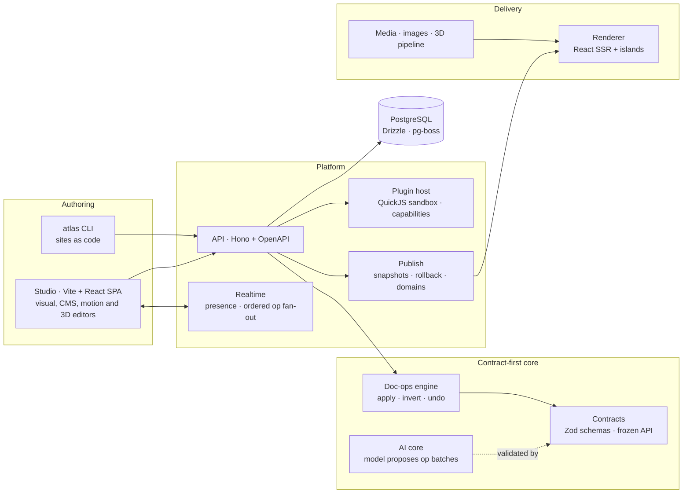

  

## About me

I architect and ship **multi-tenant SaaS platforms, visual editors and immersive web experiences** — from the data model and API contracts to the last pixel and the production server.

- **Founder & lead architect of Atlas** — a next-generation website builder and CMS.
- **Running [Tychalog](https://tychalog.com)** — software, web and growth for the German Mittelstand and the MENA market.
- **AI-native engineering** — Claude Code agents plan, build, review and integrate behind strict quality gates.
- **Trilingual by default** — English, German and Arabic with full right-to-left support, and German compliance (DSGVO, Impressum, BFSG) built in.
- **Focus** — contract-first architecture · security by design · performance budgets · 3D and motion on the web.

## Atlas — flagship project

> **A next-generation website builder and CMS — open to developers, visual for designers, secure by architecture.** 
> Private · pre-launch · in development since February 2026; the current codebase was re-founded on Master Plan v1 in September 2026.

<table>
  <tr>
    <td align="center" width="20%"><h3>52</h3>workspace packages</td>
    <td align="center" width="20%"><h3>764k</h3>lines of TypeScript</td>
    <td align="center" width="20%"><h3>1,263</h3>test files</td>
    <td align="center" width="20%"><h3>375</h3>decision records</td>
    <td align="center" width="20%"><h3>975</h3>commits since Sep 2026</td>
  </tr>
</table>

Measured from the repository on 27 October 2026 — 5 apps + 47 packages · 1,075 unit, 176 end-to-end and 12 release-gate test files · 44 RFCs.

### What's inside

| Track | What it delivers |
|---|---|
| **Kernel** | Contract-first document model · fast op engine that applies and inverts ops with incremental validation · undo history · frozen, versioned contracts with a generated OpenAPI client |
| **Content** | Collections, entries and field editors · WordPress importer (content, media, redirects) · forms with spam defence and double opt-in · CRM contacts and pipelines |
| **Editor** | Visual canvas that hosts the real renderer · selection model, command bus and keymap · inspector controls for every style kind · rich text · RTL-safe design system |
| **Renderer** | React SSR with islands · deterministic atomic CSS compiled from style declarations · responsive image delivery · SEO: meta, sitemaps, hreflang, structured data |
| **Motion & 3D** | One timeline engine for DOM, 3D and variables · React Three Fiber scenes with quality tiers and fallbacks · glTF pipeline (meshopt, LODs, KTX2) · outliner, gizmos and material editor |
| **Platform** | Multi-tenant API · realtime multiplayer editing (presence, ordered op fan-out) · QuickJS plugin sandbox with capabilities, SDK and marketplace · publish, rollback and custom domains · billing · mail and campaigns · cookieless analytics · export as static zip or Vite + React project · `atlas` CLI for sites as code |

**Compliance built in:** Impressum, Datenschutz and BFSG generators with an imprint checker · DSGVO consent log · cookieless first-party analytics · passkey sign-in (WebAuthn).

### Architecture

### How the codebase stays honest

- **Contracts first** — schemas are frozen and checked on every run; the typed API client and the developer docs are generated from them.
- **Architecture guards** — package boundaries, code ownership, licence policy, browser-safe imports, secret scanning, dangerous-API detection, single source of truth.
- **Security audits** — authentication, privilege escalation, XSS, cross-tenant leaks, load, backup and restore.
- **Release gates** — Playwright milestone gates, a 3D performance gate, Lighthouse budgets, visual regression and property-based tests.
- **Decisions on record** — 375 ADRs and 44 RFCs live next to the code.

## Products & platforms

<table>
<tr>
<td width="50%" valign="top">

### [Tychalog](https://tychalog.com)
**The agency — and its production line.**

- **“A Cosmic Journey”** — a WebGL site with no conventional UI: information assembles from stardust across six worlds linked by folding portals.
- **Template production line** — 50+ sites for the German Mittelstand (Standard and Premium) on one shared config, UI kit and legal pack, with SEO and JSON-LD built in.
- **Internal platform** — team accounting and cross-site traffic analytics.

      

</td>
<td width="50%" valign="top">

### [Zetix](https://zetix.de)
**The operating system for device-repair shops.**

- **Live repair board**, a public customer tracking portal and digital warranties (PDF + QR).
- **In-browser barcode and QR scanning**, maps, Stripe payments, S3 storage and bot protection.
- **DE / EN / AR** with full RTL · Android build · hardened production server with a dedicated backup server.

      

</td>
</tr>
<tr>
<td width="50%" valign="top">

### [PhoneX](https://phonexstore.de)
**Headless e-commerce on Medusa 2.**

- **Storefront and owner panel** compiled into single HTML files from several design sources.
- **Python wiring** swaps hard-coded data for live API calls without touching the design.
- **Reproducible rebuild and redeploy tooling** for the shop and its API.

     

</td>
<td width="50%" valign="top">

### [Handyteile Premium](https://handytp.de)
**B2B wholesale for phone parts, accessories and tools.**

- **Business-only access** — prices, stock and cart unlock only after the owner approves the account.
- **Owner control panel** in DE / EN / AR with team logins and supplier catalogue import.
- **Medusa 2 backend** · static storefront and panel with no build step · Docker locally, pm2 + nginx in production.

     

</td>
</tr>
</table>

## Tech stack

<table>
<tr>
<td width="150"><b>Languages</b></td>
<td></td>
</tr>
<tr>
<td><b>Frontend</b></td>
<td> 
   </td>
</tr>
<tr>
<td><b>3D & motion</b></td>
<td> 
    </td>
</tr>
<tr>
<td><b>Backend & data</b></td>
<td> 
     </td>
</tr>
<tr>
<td><b>Mobile & desktop</b></td>
<td></td>
</tr>
<tr>
<td><b>DevOps & cloud</b></td>
<td> 
</td>
</tr>
<tr>
<td><b>Testing & quality</b></td>
<td> 
    </td>
</tr>
<tr>
<td><b>AI</b></td>
<td>   </td>
</tr>
</table>

## How I build — AI-native engineering

Claude Code is part of my toolchain from the first plan to the last deploy:

- **Plan** — a master plan, RFCs and task briefs with explicit contracts before any code is written.
- **Build** — parallel agents work in isolated git worktrees, each inside a clear ownership boundary.
- **Review** — independent reviewers check every change against the brief and the contracts.
- **Gate & integrate** — types, lint, tests and architecture guards must pass before anything reaches `main`.
- **Operate** — the same workflow covers audits, server hardening, backups, migrations and documentation.

## Activity

  

  <picture>
    <source media="(prefers-color-scheme: dark)" srcset="https://raw.githubusercontent.com/ovopro3223/ovopro3223/output/github-snake-dark.svg">
    
  </picture>

Most of my work lives in private repositories — the graph counts those contributions too.

<b>نبذة بالعربية</b>

 

مهندس برمجيات Full-Stack ومؤسس منصات SaaS، مقيم في ألمانيا.

- أبني **Atlas**: منصة من الجيل الجديد لبناء المواقع وإدارة المحتوى — مفتوحة للمبرمجين، مرئية للمصممين، وآمنة بالبنية.
- أدير **Tychalog** لخدمة الشركات الألمانية المتوسطة (Mittelstand) والسوق العربي: برمجيات ومواقع ونمو.
- منتجاتي ثلاثية اللغة (العربية والألمانية والإنجليزية) مع دعم كامل للكتابة من اليمين إلى اليسار، ومتوافقة مع المتطلبات القانونية الألمانية.
- أعمل بأسلوب هندسي مدعوم بالذكاء الاصطناعي (Claude Code): تخطيط، تنفيذ متوازٍ، مراجعة مستقلة، وبوابات جودة على كل تغيير.

<b>Kurzprofil auf Deutsch</b>

 

Full-Stack Software Architect und SaaS-Gründer mit Sitz in Deutschland.

- Ich entwickle **Atlas** – eine Website-Builder- und CMS-Plattform der nächsten Generation: offen für Entwickler, visuell für Designer, sicher durch Architektur.
- Mit **Tychalog** realisiere ich Software, Websites und Wachstum für den deutschen Mittelstand und den MENA-Markt.
- Meine Produkte sind dreisprachig (Deutsch, Englisch, Arabisch inkl. RTL) – mit DSGVO, Impressum, Datenschutz und BFSG von Anfang an.
- KI-gestützter Entwicklungsprozess mit Claude Code: Planung, parallele Umsetzung, unabhängige Reviews und Quality Gates bei jeder Änderung.

 
<b>Building something ambitious? Let's talk — <a href="https://tychalog.com">tychalog.com</a></b>

